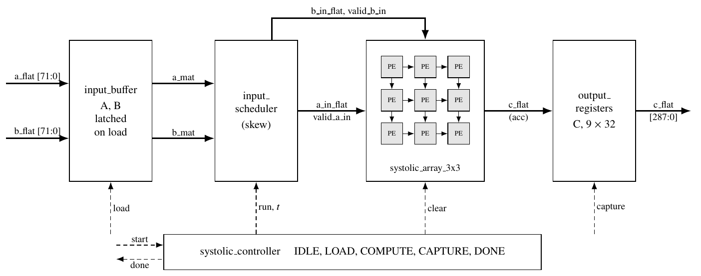
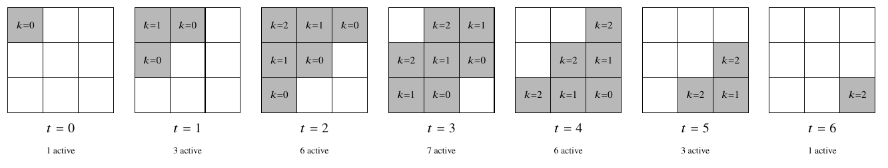
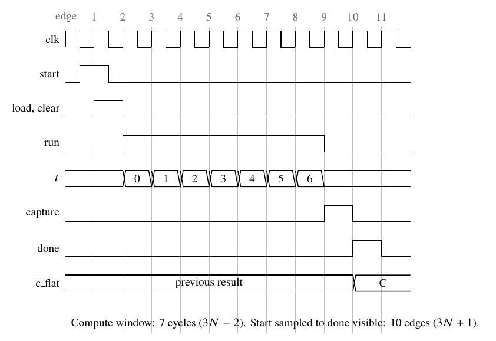
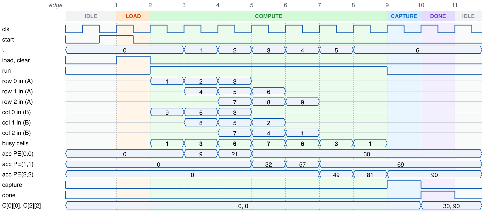

# SysMAC: Systolic Array Matrix Multiplication Accelerator

3x3 output-stationary systolic array. Signed 8-bit inputs, signed 32-bit accumulators. Verilog.

Modern Computer Architecture, B.Tech (CS&AI), Project 12.

- Phase I report: `report/sysmac_phase1.pdf`
- Prototype video: https://drive.google.com/drive/folders/1R3c7u3mTEjUZaHcT-eIhnQrd_gHrLYgV?usp=sharing
- Interface: [`docs/port_spec.md`](docs/port_spec.md)

## How it works

`C = A x B` needs 27 multiply-accumulates for 3x3 matrices. Each processing
element PE(i,j) keeps the running sum for `C[i][j]`. Rows of A enter from the
left and move right one PE per cycle; columns of B enter from the top and move
down. Row i of A is delayed by i cycles and column j of B by j cycles, so
`A[i][k]` and `B[k][j]` meet at PE(i,j) at cycle `t = i + j + k`. All 27
products are done after 7 cycles.





One job, cycle by cycle (start sampled at edge 1, `done` visible after edge 10):



The same job as recorded by the simulator (`scripts/plot_waveform.py` draws it
from `sim/waveforms/demo.vcd`):



More figures in `docs/figures/`: the PE, the skewed input staircase and the
controller FSM. Sources are TikZ (`fig_*.tex`).

## Layout
- `rtl/` synthesizable Verilog
- `tb/` testbenches
- `sim/` waveforms, logs, test vectors (`sim/vectors/`)
- `scripts/` run and reference scripts
- `synthesis/` synthesis scripts and results (`run_yosys.sh`, `run_nextpnr.sh`, `*/summary.txt`)
- `docs/` diagrams, `port_spec.md`
- `report/` IEEE report

## Run the tests

Needs Python 3 and Icarus Verilog (`brew install icarus-verilog` on macOS; the
OSS CAD Suite plus Git Bash on Windows). Run from the repo root:

```
scripts/run_simulation.sh            # every testbench
scripts/run_simulation.sh top        # only testbenches with "top" in the name
scripts/run_simulation.sh --waves    # keep the VCD files in sim/
```

Every testbench is compiled against all of `rtl/`. A testbench whose module
(from `docs/port_spec.md`) does not exist yet shows as `WAITING`, not as a
failure; an unknown module name shows as `FAIL` (usually a typo). A testbench
passes only if it prints "pass", prints no fail/fatal/error, and finishes
within 120 s (`TIMEOUT=300 scripts/run_simulation.sh` to change it). Logs go
to `sim/build/logs/`, which git ignores.

For the live demo, `scripts/demo.sh` runs every testbench, prints the demo
result matrix and the systolic vs sequential timing comparison.

To view a waveform: `scripts/run_simulation.sh --waves`, then open a `.vcd`
from `sim/` (for example `sim/top_waveform.vcd`) in GTKWave or Surfer
(`brew install surfer`).

## Reference model

`scripts/reference_model.py` is an independent Python model of the design:
the plain triple loop, a register-level model of the array, and the order of
operations of the sequential baseline. They are checked against each other
(and NumPy) before any vectors are written.

```
python3 scripts/reference_model.py schedule    # input_scheduler outputs for t = 0..6, demo matrices
python3 scripts/reference_model.py wavefront   # which product each PE computes in each cycle
python3 scripts/reference_model.py cycles      # cycle counts, utilisation, accumulator width for N = 2, 3, 4, 8, 16
python3 scripts/reference_model.py vectors     # regenerate sim/vectors/
```

Files in `sim/vectors/` (hex, one word per line, for `$readmemh`):

| File | One line | Use |
| --- | --- | --- |
| `jobs_a.hex`, `jobs_b.hex` | `a_flat` / `b_flat` of one job, 72 bits | top-level and baseline tests |
| `jobs_c.hex` | expected `c_flat`, 288 bits | top-level and baseline tests |
| `jobs.txt` | name of each job | reading logs |
| `trace_in.hex` | one compute cycle: `{valid_b_in, valid_a_in, b_in_flat, a_in_flat}`, 54 bits | expected `input_scheduler` output per cycle; stimulus for `tb_systolic_array` |
| `trace_c.hex` | every accumulator after that cycle's edge, 288 bits | array test: cycle-by-cycle check of `systolic_array_3x3` |

There are 112 jobs (12 directed, 100 random), 7 trace lines per job.

## Sequential baseline

`rtl/seq_matmul.v` computes the same product with one multiply-accumulate unit,
one MAC per cycle. It has the same ports and handshake as
`systolic_accelerator_top`, so `tb/tb_matmul_vectors.v` drives either one with
the same vectors.

| | Compute cycles | Start to done | Multipliers |
| --- | --- | --- | --- |
| Systolic array | 7 | 10 | 9 |
| Sequential baseline | 27 | 29 | 1 |

The ratio is in cycles only. Clock frequency and FPGA resources for both come
from synthesis. Both rows are measured by `tb_matmul_vectors.v` on the
integrated design (112 jobs each). Both designs guarantee `c_flat` only while `done` is high: the
baseline rewrites it during the next job, while the systolic top keeps the old
result until its next capture.

## Do the tests catch bugs?

```
python3 scripts/mutation_check.py      # about 30 s; never edits the repo
```

It copies the repo to a temporary folder, plants one realistic bug at a time
(late skew, transposed B, unsigned multiply, 16-bit accumulator, missing
clear, controller ending early or restarting while busy, input buffer not
latching, baseline not restarting its sum) and reruns every testbench. Each
bug must make at least one testbench fail. `--markdown` prints the table used
in the report.

## Synthesis

```
synthesis/run_yosys.sh                 # needs yosys; about 20 s
```

Writes `synthesis/yosys/summary.txt`: DSP, flip-flop and LUT counts for the
systolic top and the baseline, with module boundaries kept (hierarchical) and
flattened. The two differ because flattening removes the unused forwarding
registers of the edge PEs. These are cell counts only, without timing.

For a maximum clock frequency without Vivado, both designs are placed and
routed on a Lattice iCE40 HX8K:

```
synthesis/run_nextpnr.sh               # needs yosys and nextpnr-ice40; about a minute
```

`brew install yosys nextpnr-ice40` on macOS; both come with the OSS CAD Suite.
It writes `synthesis/nextpnr/summary.txt`: LUT4, flip-flop and carry counts,
Fmax (median over placement seeds 1-5, 50 MHz constraint) and latency in ns.
The design has more I/O bits than the package has pins, so for place and route
it sits in `synthesis/fmax_harness.v`, which registers every port.

| | LUT4 | FF | Fmax (MHz) | Start to done |
| --- | ---: | ---: | ---: | ---: |
| Systolic | 3256 | 830 | 51.2 | 195 ns |
| Sequential | 909 | 474 | 45.6 | 636 ns |

The array is 3.25x faster in time. The iCE40 has no multiplier blocks, so it
needs 3.6x the LUTs, and LUTs x time is about 10% worse than the baseline.

## Rules
- Module ports must match `docs/port_spec.md`.
- Commit your own files, small commits.
